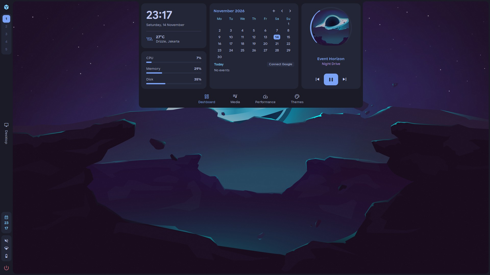
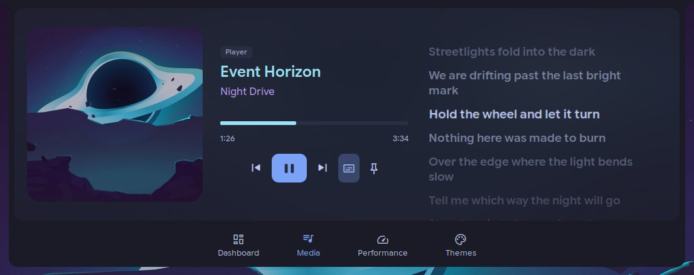
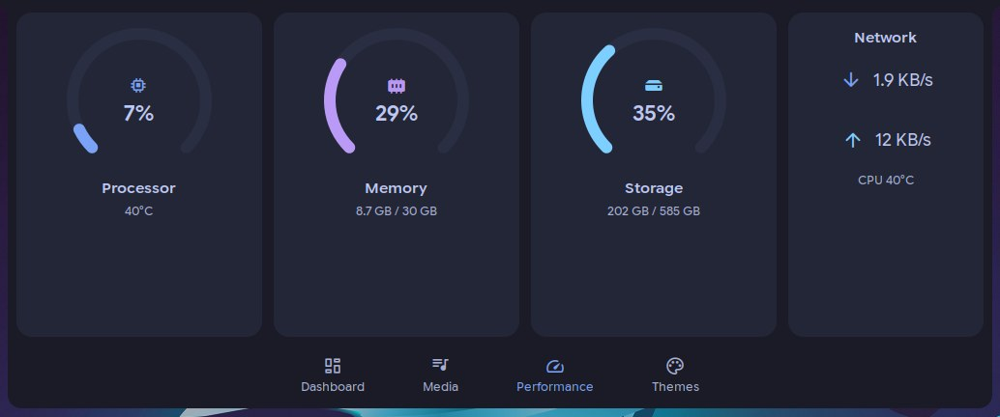
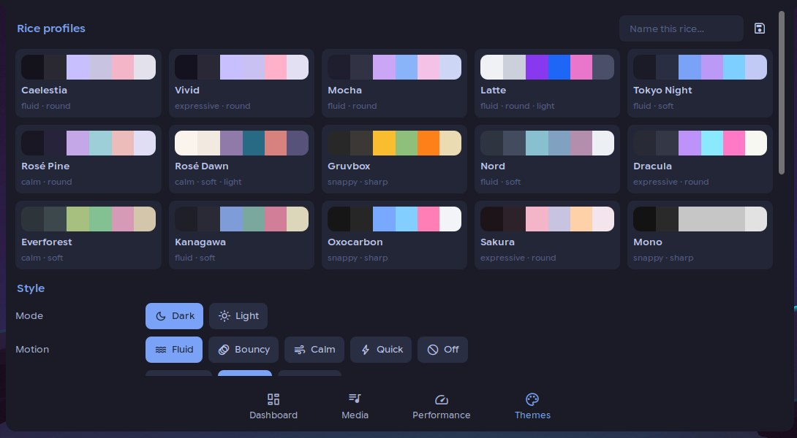
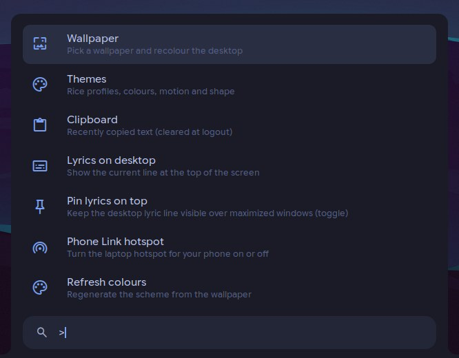
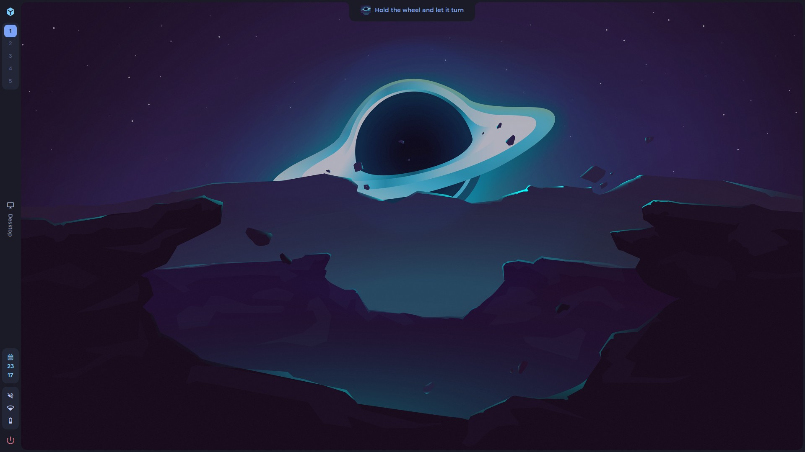
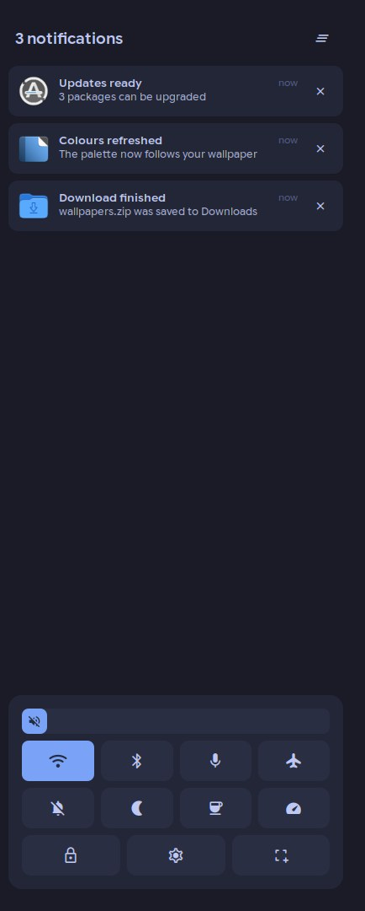
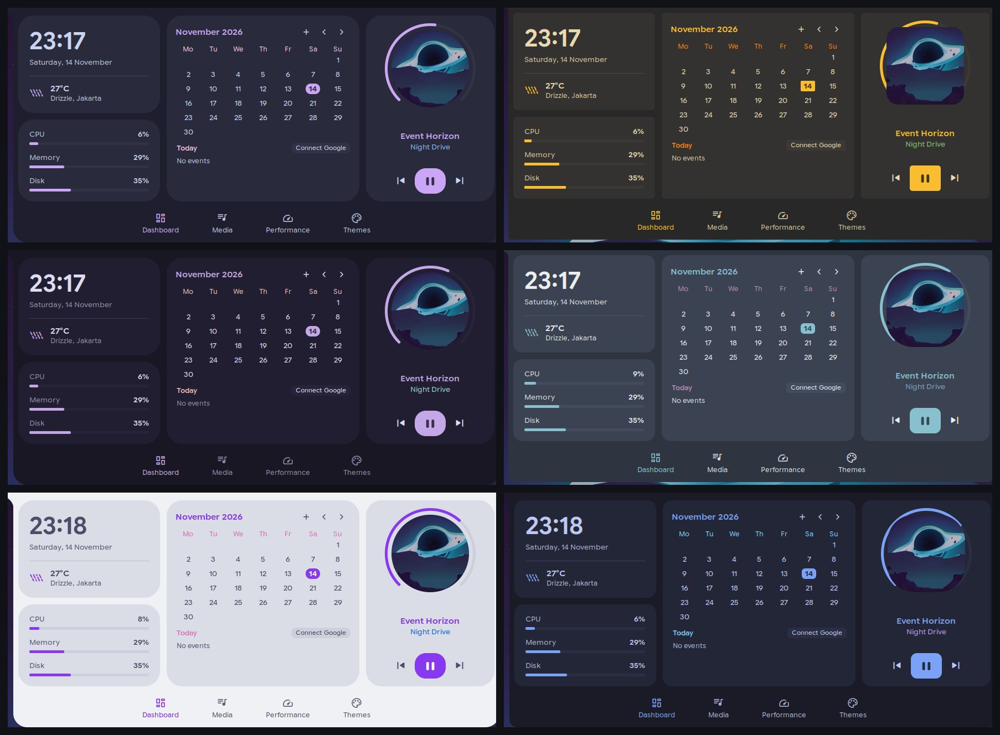

<div align="center">

# Caelestia for GNOME

**The Caelestia desktop, rebuilt as a GNOME Shell extension. Runs on stock Ubuntu, installs with one command.**




</div>

```bash
wget -qO- https://raw.githubusercontent.com/szyxxx/Caelestia-GNOME/main/install.sh | bash
```

Then log out and back in. That's it.

> Based on the look of [caelestia-dots/shell](https://github.com/caelestia-dots/shell), which needs
> Hyprland. This one keeps you on GNOME. Screenshots show the Tokyo Night profile; a fresh install
> starts with soft grey tones taken from the wallpaper.

## What you get

<table>
<tr>
<td width="50%"><br><b>Media with synced lyrics</b><br>Album art, controls and the current line, for any player.</td>
<td width="50%"><br><b>Performance</b><br>Processor, memory, storage, network and temperature.</td>
</tr>
<tr>
<td><br><b>15 rice profiles</b><br>Or colours from your wallpaper. Motion and corner shape are yours to pick.</td>
<td><br><b>Launcher on Super</b><br>Apps, wallpapers, clipboard history and quick actions.</td>
</tr>
</table>



<table>
<tr>
<td width="24%"></td>
<td>

**Also in the box**

- **Left bar and screen border** fused into one frame: workspaces, window title, clock, status and power
- **Sidebar** with notifications and quick toggles
- **Popouts** for Wi-Fi, Bluetooth, battery (with charge limit) and your phone
- **Lyric line on the desktop** that steps aside for maximized windows
- **Spring motion** for windows, drawers and workspace switches
- **Calendar** with your Google Calendar events
- **Phone link** through GSConnect: battery, clipboard, send files, drag-to-share
- **Colours everywhere**: shell, GTK apps and the terminal follow the same palette

</td>
</tr>
</table>

### One wallpaper, many moods



<sub>Mocha · Gruvbox · Rosé Pine · Nord · Latte · Tokyo Night. Switch with <code>caelestia-scheme --profile NAME</code> or in the dashboard's Themes tab.</sub>

## Install

**Needs GNOME 50 (Ubuntu 26.04).** It has only been built and tested there.

```bash
wget -qO- https://raw.githubusercontent.com/szyxxx/Caelestia-GNOME/main/install.sh | bash
```

The installer puts everything in your home folder, backs up the settings it changes, and asks for
`sudo` only if an Ubuntu package it needs is missing. It asks two questions (weather city, and
whether you want to change any apps); `-y` skips them.

To pass options, download it first:

```bash
wget -q https://raw.githubusercontent.com/szyxxx/Caelestia-GNOME/main/install.sh
bash install.sh --pick-apps
```

## Options

| Option | What it does |
| --- | --- |
| `-y`, `--yes` | Ask nothing: keep this computer's own apps, take every default |
| `--pick-apps` | Choose browser, files, terminal, editor, music app and dock from menus |
| `--browser APP`, `--files APP`, `--terminal APP`, `--editor APP`, `--music APP` | Make `APP` the default for that role (a desktop id or part of the app's name) |
| `--dock VALUE` | `keep` (default), `auto`, or a comma list of apps to pin |
| `--no-dock-icons` | Leave dock icons as they are |
| `--city NAME` | Place for the dashboard weather (default: the city of your time zone) |
| `--no-wallpaper` | Keep your wallpaper; the colours are taken from it |
| `--no-fonts` | Do not download the fonts |
| `--force` | Try on a GNOME version other than 50 |
| `--uninstall` | Put everything back and delete the files |

## Your apps, not mine

Nothing in here assumes a particular browser, terminal or music player. By default every role is
`auto`, which means "whatever this computer already uses", and your pinned dock apps are left alone.

```bash
caelestia-apps                      # show what is used for each role
caelestia-apps pick                 # choose from menus
caelestia-apps list browser         # installed apps that fit a role
caelestia-apps set browser firefox  # by desktop id or part of the name
caelestia-apps set music spotify    # opens when you press play with nothing playing
caelestia-apps set music none
caelestia-apps dock auto            # pin browser, files, terminal, editor, music
caelestia-apps dock firefox,nautilus,spotify
caelestia-apps dock keep            # leave the dock as it is
```

The choices live in `~/.config/caelestia-gnome/apps.conf`; edit it and run `caelestia-apps apply`.
Roles are `browser`, `files`, `terminal`, `editor` and `music`. Naming an app makes it the system
default for that role; `auto` writes nothing.

## Everyday commands

| Command | What it does |
| --- | --- |
| `Super` | Launcher: apps, `>wall` wallpapers, `>clip` clipboard, actions |
| `Super+D` / `Super+N` / `Super+X` | Dashboard / sidebar / power menu |
| `Super+1…5`, `Super+Shift+1…5` | Go to / move a window to a workspace |
| `caelestia-scheme --list` | Rice profiles and palettes (also in the dashboard's Themes tab) |
| `caelestia-scheme --profile mocha` | Apply a profile; see `caelestia-scheme --help` for colours, motion, corners, border |
| `caelestia-weather CITY` | Change the weather place |
| `caelestia-icons` | Re-tile the dock icons after pinning a new app |
| `caelestia-charge 80` | Battery charge limit, on laptops that support one (`caelestia-charge --setup` once) |
| `caelestia-apply` | Re-apply the look after an update |

Other settings are in `~/.config/caelestia-gnome/config.json` (`lyrics`, `lyricsFallback`,
`lyricPill`, `phoneLinkAuto`).

Optional: install [GSConnect](https://extensions.gnome.org/extension/1319/gsconnect/) and pair your
phone to get the phone popout (battery, clipboard, send files, ring) and drag-to-share.

## Undo

```bash
caelestia-restore            # your settings, GTK colours, default apps and dock icons go back
caelestia-restore --remove   # the same, and delete everything the installer added
```

## What the installer changes

- Adds the extension `caelestia-gnome@szyx` and, if missing, GNOME's User Themes extension.
- Turns off Ubuntu Dock and desktop icons (the left bar replaces them). Your other extensions stay on.
- Sets the wallpaper, interface fonts, dark style, 5 fixed workspaces, a close-only title bar and
  the shortcuts above.
- Writes GTK colour overrides (`~/.config/gtk-3.0`, `gtk-4.0`) and a terminal palette for Ptyxis.
- Downloads three fonts into `~/.local/share/fonts/caelestia` and the wallpaper.

Lyrics send the title and artist of the playing track to lrclib.net and music.163.com; the weather
comes from open-meteo.com. Turn lyrics off with `"lyrics": false` in `config.json`.

## Credits

Design from [caelestia-dots/shell](https://github.com/caelestia-dots/shell), which also provides the
wallpaper and Google Sans Flex. Icons are [Material Symbols](https://github.com/google/material-design-icons);
the monospace font is CaskaydiaCove from [Nerd Fonts](https://github.com/ryanoasis/nerd-fonts).
These are downloaded from their own repositories at install time and are not part of this repository.
